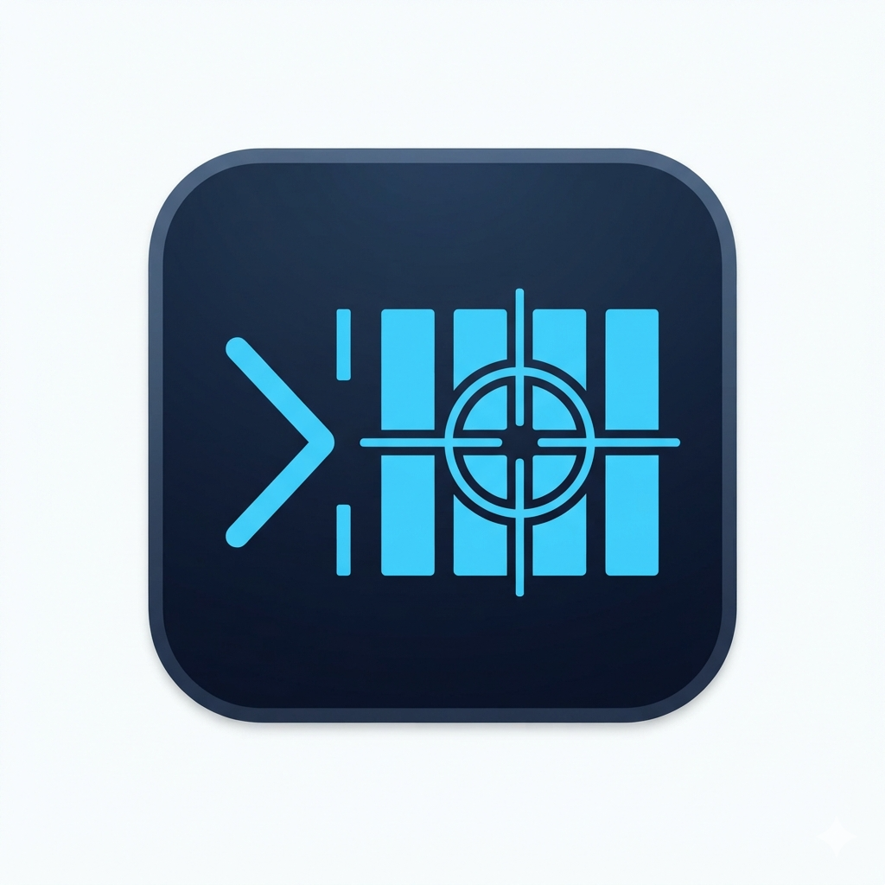
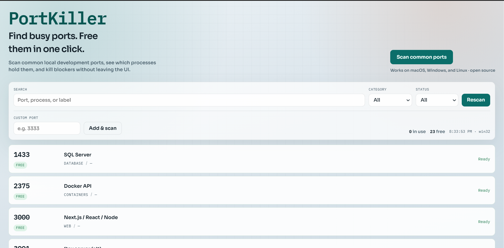

<p align="center">
  
</p>

<h1 align="center">PortKiller</h1>

<p align="center">Open-source, cross-platform desktop app and CLI that scan local TCP ports and free them with one click or <code>portkill 3000</code>.</p>

<p align="center">
  
  
</p>

## Features

- **Common port presets** — web servers, databases, caches, queues, containers, and more
- **Live status** — see which ports are free vs occupied, with process name and PID
- **Terminal command** — install once, then run `portkill 3000` without opening the UI
- **One-click kill** — free a blocked port from the interactive UI
- **Filters** — search, category, and free/in-use filters
- **Custom ports** — add any TCP port (1–65535) and scan it
- **Cross-platform** — macOS, Windows, and Linux via Electron

## Screenshots / UI



The main window shows:

1. **PortKiller** brand + scan action
2. Search / category / status filters
3. A list of ports with **Free** or **In use** state
4. **Kill & free** on occupied rows

> Tip: running `npm run dev` opens the UI in the browser with a safe demo backend. Use `npm run electron:dev` for real port scanning and process killing.

## Quick start

```bash
npm install
npm run electron:dev
```

Browser-only UI preview (demo data, no real kills):

```bash
npm run dev
```

## CLI installation and usage

Requires Node.js 18+ and npm. From this repository, install once:

```bash
npm install
npm run build:cli
npm install -g .
```

Then, from any directory:

```bash
portkill 3000
```

The command force terminates the processes listening on that TCP port and verifies it is free. No confirmation prompt is required. An already-free port is a successful no-op. Killing a listener terminates its whole process, including any other ports it serves.

```bash
portkill 5173 --graceful  # Request termination instead of forcing it
portkill --help
portkill --version
```

Exit codes: `0` = port is free, `1` = scanning/killing failed or port remains occupied, `2` = invalid arguments. UDP ports and remote hosts are not supported.

The CLI runs under Node; it does not launch Electron or require the desktop app. Installing the desktop app alone does not add `portkill` to your terminal.

### Install on another machine

Build an npm package from this checkout:

```bash
npm pack
```

Copy the generated `portkiller-1.0.2.tgz` to a macOS, Windows, or Linux machine with Node.js, then install it:

```bash
npm install -g /path/to/portkiller-1.0.2.tgz
portkill 3000
```

`npm pack` builds the CLI automatically. This does not publish anything to npm; registry installation by package name requires a separate release. Local directory installs may link to the checkout, so keep it in place and rebuild after CLI changes. Installing the tarball creates an independent copy. Uninstall with `npm uninstall -g portkiller`.

If `portkill` is not found, ensure your npm global executable directory is in `PATH` (the npm prefix on Windows, or `<prefix>/bin` on macOS/Linux; inspect it with `npm prefix -g`).

## Scripts

- `npm run electron:dev` — Vite + Electron with live reload
- `npm run dev` — browser UI demo
- `npm run build:cli` — compile the Node CLI and shared service
- `npm run build` — compile renderer, Electron, and CLI
- `npm run electron:build` — build desktop installers
- `npm test` — build CLI and run tests, including disposable real listener checks
- `npm run typecheck` — check UI, Electron, and CLI TypeScript
- `npm run electron:build:mac` — macOS installers (x64 + arm64)
- `npm run electron:build:win` — Windows NSIS installer and portable executable
- `npm run electron:build:linux` — Linux AppImage and Debian package
- `npm run release:tag` — create a version tag, optionally bumping the version

## GitHub Releases (all platforms)

CI builds installers on **macOS, Windows, and Linux** and attaches them to a GitHub Release when you push a version tag.

### 1. Ship a release (recommended)

```bash
# optionally bump version + commit, then create annotated tag
npm run release:tag patch    # or: minor | major | 1.2.3

# push commit + tag — triggers .github/workflows/release.yml
git push origin HEAD && git push origin v1.0.1
```

Or tag manually:

```bash
git tag -a v1.0.0 -m "PortKiller v1.0.0"
git push origin v1.0.0
```

### 2. What gets published

| Platform | Artifacts |
| --- | --- |
| macOS | `PortKiller-*-mac-x64.dmg`, `PortKiller-*-mac-arm64.dmg` (+ zip) |
| Windows | NSIS installer `.exe`, portable `.exe` |
| Linux | `.AppImage`, `.deb` |

Find them on the [Releases](https://github.com/HassanRasoo98/portkiller/releases) page after the workflow finishes.

### 3. Local packaging (single OS only)

```bash
npm run electron:build:mac     # on a Mac
npm run electron:build:win     # on Windows (or use CI)
npm run electron:build:linux   # on Linux
```

Outputs land in `release/`. You cannot reliably cross-compile all three platforms from one machine — use the GitHub Actions workflow for full coverage.

### 4. macOS Gatekeeper / signing (optional)

CI publishes **unsigned** Mac builds by default (Gatekeeper may require **Right-click → Open** the first time).

To notarize signed builds later, configure Apple Developer cert secrets and update the macOS packaging step to enable `CSC_IDENTITY_AUTO_DISCOVERY` with `CSC_LINK` / notarization credentials.

## How it works

- **macOS / Linux:** detect TCP listeners with `lsof`, falling back to `ss` on Linux; terminate with `kill -9` or `kill -TERM`.
- **Windows:** detect local TCP listeners with `netstat` + `tasklist`; terminate with `taskkill /F`, or without `/F` for `--graceful`.

Linux needs `lsof` or `ss` installed. Scanner failures report errors rather than claiming the port is free. Process visibility depends on OS permissions; another user's listener may need elevated privileges. Kill failures can require running the terminal as administrator on Windows or using sudo on macOS/Linux. A server supervised by a process manager may restart immediately.

## Common ports included

Examples: `3000`, `5173`, `8080`, `5432`, `3306`, `27017`, `6379`, `9200`, `5672`, `19000`, and others. Full list lives in [`shared/common-ports.ts`](shared/common-ports.ts).

## Project layout

```
bin/               npm portkill executable
cli/               CLI arguments, termination, verification
electron/          Main process, preload, shared Node port scan/kill
shared/            Shared port definitions and types
src/               React UI
portkiller-obsidian-docs/  Developer notes
```

## Troubleshooting

- **Permission errors:** quit the owning app, or run the CLI/desktop app with elevated privileges.
- **Still occupied after kill:** stop the process manager that is restarting the server, then retry or rescan.
- **Missing scanner:** install `lsof` on macOS/Linux or `ss` on Linux.
- **Command not found:** check npm's global executable directory is on `PATH` and rerun the installation steps.

Developer details are in [`portkiller-obsidian-docs/Index.md`](portkiller-obsidian-docs/Index.md).

## Security notes

- Renderer runs with `contextIsolation` and no Node integration
- Port scan / kill only via IPC from the preload bridge
- Killing processes is destructive — only free ports you intend to reclaim

## Contributing

Issues and PRs are welcome. Keep changes focused; add tests for port-list and service behavior when practical.

## License

MIT — see [LICENSE](LICENSE).
